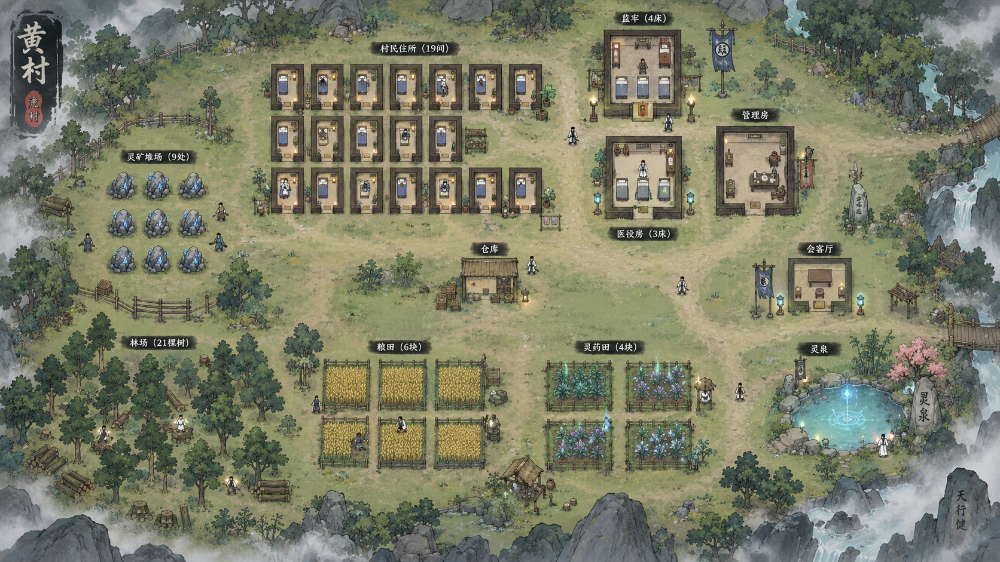

# 项目体验与美术表现差距审查

> 后续：制作人已授权本报告的人物移动与工具动作范围，[282](282-character-locomotion-and-tool-action-polish-2026-10-18.md) 已实施待人工验收。本页保留实施前审查依据与当时 Proposed 建议，当前步态参数和接线状态以 282／276 为准，其余建议未自动启动。

> 状态：审查完成；建议为 Proposed，未启动实施 | 优先级：P0 | 最后更新：2026-10-18
> 依据：当前工作区的文档、正式 Host／Core／Data 代码、Content 配置、美术原图与运行素材。当前工作区包含尚未提交的新骨架和修复，以磁盘现状为审查对象，不以 HEAD 代表全部现状。
> 制作人本次确认：希望接近《了不起的修仙模拟器》的俯视经营观感；最直接的不满是人物自主走路、主控右键移动时，走路动画像没有接上，动作不流畅。

## 核心判断

项目已经建立了有价值的系统基础：真实人物、连续户外、小队、战斗与战后返回、占领、成长、关系、事件、交易，以及较深入的凡人生活与住房实现。现在最需要补的是这些能力在正常游戏过程中的可读性、连贯性和完成度。

美术方面，人物骨骼与工具挂点的方向已经进入实现；目前仍是轻量部件样机。运行人物、环境模块、动作、反馈和界面的品质没有一起收口，导致“单个素材已经有了，整体仍像机制演示”的观感。继续增加人物 PNG 数量，对眼下的问题帮助有限。

产品方面，默认开局仍是参考关与验收配置。已经接通的系统多于玩家能连续感受到的成长内容。现阶段最有价值的工作，是先让一小片真实场景里的走、停、劳动、换工具和结果反馈可信，再用现有系统串起一段能自然游玩的修仙成长体验。

以下把三类内容分开：代码／资源可直接证实的事实、需要现场定位的反馈，以及产品建议。没有给全游戏完成百分比；目前缺少一致的分母，也没有证据支持可靠的工期估算。

## 1 目标与当前状态

| 维度 | 游戏目标 | 当前可证实状态 | 主要差距 |
| --- | --- | --- | --- |
| 玩家身份 | 具体人物成长为拥有领地的修仙势力 | 单 Active、小队、继承、实际人物与领地接管已有正式链路 | 正常开局、机缘、准备、起事与占领收益尚未组织成充分验证的体验 |
| 修仙成长 | 境界改变能做的事，地点与准备有意义 | 修炼、突破、功法、熟练、灵力承伤和纱衣远程已有实现 | 环境修炼因素未进入当前增长／突破计算；现有内容对机制变化的利用不足 |
| 战斗 | 可暂停、有准备与取舍、战果改变真实世界 | CharacterEncounter、伤亡、回归、有限参战和接管基础存在 | 当前主动技以倍率／段数差异为主；动作与命中反馈还比较抽象 |
| 经营生活 | 村里住着真实的人，规模增加后仍好管理 | 职业、需求、住房、施工、搬运、押送等已深入实现，近期范围待验 | 开局体验重心容易偏向生活状态维护；职业与停工原因不够直观 |
| 人物美术 | 俯视经营镜头下，人物行动清楚、工具可换 | 默认共用部件骨架，25 个名录身份映射 12 套 Skin | 自主／右键走路反馈未关闭；骨架、方向、握持和关键姿态仍是样机品质 |
| 环境美术 | 同一视角、尺度和笔触的国风村落 | 草地、部分树矿、床、货箱、核心、洞口等已有运行替换 | 地板、墙、门、道路、田地与作物层等大面积内容仍混旧表现 |
| 界面与反馈 | 玩家看懂人物、工作、危险与成果 | 正式功能入口多，已有少量图标和程序 VFX | 正式面板仍带诊断信息，人物头像未接，劳动／修炼／恢复反馈缺少统一语言 |
| 项目状态 | 可靠区分设计、实现、人工验收与封板 | 既有专项封板有清晰边界，最新日志也记录 Pending | 入口和“唯一状态表”仍混入已过时状态，增加判断负担 |

目标依据为 [愿景](../00-project/01-vision.md)、[差异化](../10-benchmark/14-borrow-and-differentiate.md)、[开局体验](../20-systems/20-opening-experience.md)、[2K](../20-systems/2K-rpg-first-character-control-playerparty-and-continuous-hex-world.md) 和现行冻结边界。制作人本次确认的是画面与经营观感；玩法控制仍按当前 RPG-First／单 Active 契约理解。

## 2 人物已经采用什么动画方案

当前默认是 Unity `Transform + SpriteRenderer` 组成的 HumanCommonRig。代码用关节旋转、位移和插值驱动部件，共用动作并替换人物部件与附件。它属于轻量部件式骨骼动画；没有接入 Spine，也没有使用 Unity `SpriteSkin` 的权重网格变形。文件名中保留的 Spine 字样是历史路径。

当前关系是：

```text
真实人物与移动／工作／战斗事实
    → EntityView 读取表现状态
    → 共用 HumanCommonRig 动作
    → 人物 Skin ＋ 工作工具／战斗武器附件
```

这条分工符合替换斧头、镐、锄具和武器的需求。身体动作可以复用，手持物可以独立替换；不需要为每个工具重新生成一套整身人物帧。但换工具还必须匹配握点、手型、方向遮挡和动作轨迹，仅替换图片并不足够。

旧逐帧仍承担资源缺失回退与对照用途。短逐帧仍适合挥砍痕、火花等效果；不应把“人物使用骨骼”理解为所有资源都必须骨骼化。

证据：`EntityViewSpawner.cs:18–22,118–122,291–295`；`HumanCommonRigView.cs:47–103,138–165`；[276 当前技术路线](276-art-tech-route-spine-frame-static-v1-2026-10-16.md)；[279 名录迁移](279-human-common-rig-roster-migration-2026-10-17.md)；[280 最新修复](280-animation-binding-audit-and-fix-2026-10-18.md)。

### 工具替换已经有基础，正式装备仍是未来范围

工作工具和战斗武器已经分开。工作手势能对应斧、镐、锄和镰；播种／照料可以空手。巡卫默认长枪；工作斧不会自动成为空手普攻的武器。附件支持 Sprite、握点、尺寸和角度覆盖。

现有附件没有独立铲子或施工锤。即使以后补上，也应先明确是哪种已存在工作使用它；无需为展示铲子先创建装备属性或耐久系统。

`HumanCommonRigEquipment` 当前只是 View 生命周期内的视觉绑定。它不负责背包、持久装备、伤害属性或存档；重建后也不承诺保留手动视觉覆盖。因而“工作时自动拿合适工具”与“玩家获得、装备并保存一把武器”是两项不同范围，后者尚未实现。

证据：`HumanCommonRigEquipment.cs:6–61`；`HostFarmFieldLabor.cs:86–100`；`HostCharacterVisualContext.cs:129–145`；[280 边界说明](280-animation-binding-audit-and-fix-2026-10-18.md)。

## 3 自主与右键走路动画是本次最高优先问题

制作人报告的现象应保留为尚未关闭的运行问题。当前磁盘代码已有步行接线，不能再简单描述为“还没写 Walk”，也不能凭离线编译或函数存在认定现场已经正常。

| 移动情形 | 当前磁盘接线 | 本次判断 |
| --- | --- | --- |
| 主控右键寻路 | `HostMoveController.Update → TickMoves → RecordLocomotion → EntityView.UpdateRuntimeArt → HostCharacterArtState → HumanCommonRigView.Apply` | 已找到明确调用链；尚未确定现场为何没有播出或看不出来 |
| 近场日程／受管居民移动 | `HostNpcScheduleMover` 向同一移动控制器提交路径，再走上述位移记录 | 同样有接线；不能把所有 NPC 归为没接动画 |
| WASD 移动 | `TickDirectWasdMove → RecordLocomotion` | 有独立记录入口，可作为同一个人物的对照 |
| 宏观 NPC Squad 投影 | Tick 后直接设置 View 位置，把已观测位移分摊成步态 | 根位置仍跳步是确定限制；持续摆腿不能消除位置跳变 |
| 资源失败后的旧驱动 | 新骨架失败回退 LegacySprite；部分身份旧链只有静图 | 若现场发生回退，可能仍是静图移动；本次没有证据证明它就是当前原因 |

关键代码：`HostMoveController.cs:325–380,1012–1014`；`HostNpcScheduleMover.cs:128` 起的意图／路径处理；`EntityView.cs:59–76,389–442`；`HostCharacterArtState.cs:21–49`；`HumanCommonRigView.cs:188–199`；`HostNpcSquadContinuousPresenter.cs:28–32,60–62`。

当前动画判断要求本帧由合法移动源记录有效位移，或存在宏观投影步态；普通 Transform 位置变化在移动控制器存在时不会自动被视为走路。这有助于排除瞬移、拥挤分离和被搬运，但也意味着任何绕开位移记录的真实移动路径都会漏播。修复应核查实际现场路径，不能只把所有 Transform 变化都改成 Walk。

本次没有找到右键／近场日程这两条磁盘调用链的确定断点；`ConfigureRuntimeArt` 也只在生成／补生时调用，没有证据表明每帧重置步态。资源回退、已有运行对象与新代码状态不一致、动作／生命周期抑制、步态过弱，均应作为待排除原因，不能提前写成根因。现存 Editor 日志没有提供足以确定当前故障原因的报错。

下一轮最有效的定位方式，是在制作人实际看到问题的同一场景、同一人物上同时观察：**当前视觉驱动、Profile、有效位移、选中的 Action、步态相位，以及实际腿部关节是否改变**。这几项即可区分“没有收到移动”“状态没转 Walk”“相位没有推进”“部件没有动”“确实动了但正常镜头不可辨”。复用现有检视／诊断入口即可，不需要新增测试框架或通用动画平台。

## 4 当前骨架为什么仍然显得僵硬

### 部件结构还没有形成可信的动作轮廓

每条胳膊和腿目前各是一整张图片，主要围绕肩和髋转动。缺少独立肘、腕、膝控制，也没有握柄、握拳等手型差分。四方向主要换头与躯干，侧背仍复用正面肢体。部分躯干保留明显肩／袖轮廓，再叠完整袖臂，存在双肩、接缝和侧背剪影不协调的风险。

这些事实并不意味着每个人都必须增加完整肘膝骨架。《修仙模拟器》式小人物可以保留很概括的动作。应先在正常镜头下做到轮廓清楚、脚步可辨、工具握得住；只有标杆动作确实需要时，再增加少量关节或替换手型。

证据：`HumanCommonRigView.cs:145–165,179–184`；当前村民／巡卫部件原图；[280 已记录的侧背素材边界](280-animation-binding-audit-and-fix-2026-10-18.md)。

### 工作和攻击缺少明确的接触节奏

工作主要由约 1.15 Hz 正弦驱动，砍树／采矿共用一组摆动参数，播种／照料／收割共用另一组。现在的差异主要是手臂幅度、身体倾斜和附件，没有完整表达“准备、用力、触点、短停、收回”。

砍树结算／VFX 有自己的节奏，1x 下冷却约 0.85 秒，工作姿态连续循环；战斗多在成功结算时才开始长度为 0.36 视觉秒的攻击动作，该动作推进会随倍率限速，近战闪白又同时出现。这能表达发生了一次攻击，却不保证观众看到工具／武器接触目标的那一刻才出现反馈。

建议为少数共用动作定义清楚的关键姿态和可见接触点，把落击、碎屑、命中闪光和声音组织起来。玩法伤害、产出与时间仍使用既有真源，不能改成动画事件自行结算。若需要更早的攻击预备信号，先明确正式接口和时序，避免用表现层猜测未来命中。

证据：`HumanCommonRigView.cs:203–240`；`HostDestructibleAssault.cs:314` 附近；`HostCharacterEncounter.cs:509` 附近；`HostMeleeStrikeVfx.cs:82–88`。

### 已能确认的表现限制

| 问题 | 证据 | 后果与优先级 |
| --- | --- | --- |
| 宏观小队位置按 Tick 跳变 | `HostNpcSquadContinuousPresenter.cs:28–32,60–62` | 优先和正常行走反馈一起处理；表现平滑必须保持现有位置与碰撞 authority |
| 高倍率步态限速 | 每 1.8 表现单位一循环，最多 3.5 循环／真实秒；`HostCharacterArtState.cs:8–9,39–43` | 超过每秒 6.3 表现单位后会有滑步风险；应为常用倍率规定可接受观感 |
| 床卧姿忽略床方向 | `EntityView.cs:537` 只传位置；`HumanCommonRigView.cs:306–317` 固定偏移与 83°；建设支持旋转 | 旋转床需要对应朝向和枕端；当前静态姿态不能算完整卧姿完成 |
| 双手工具只有单手挂点约束 | `HumanCommonRigView.cs:155–163,269–275` | 长枪、锄／镐的另一只手可能脱离柄；优先修标杆工具的握持 |
| 人物辨识依赖文字 | Other 共用 Skin；`HostCharacterRelationUi.cs:25–29` 头像返回 false | 优先明确主控、同伴、敌我、正在做的工作；不必马上给全部路人独立立绘 |

## 5 美术生成的实际进展

资产族登记有 55 项；两批模块人物已生成 12 套 Skin，25 个现有名录身份有映射。最新 280 记录了 17 张部件／侧头／工具图及 126 个部件范围。它们代表可追溯的素材和接线工作，不能折算成最终人物品质。

| 内容 | 已有产物与用途 | 仍欠缺 |
| --- | --- | --- |
| 人物 | 普通村民、主角三人、主管、巡卫、居民差分、执事、通用人物和江老等类别 Skin | 正常镜头动作、侧背剪影、手型、握持、个人辨识与现场移动问题 |
| 工具 | 长枪、斧、锄、镐、镰、背篓独立附件 | 对应动作、另一只手、触点；铲／施工锤尚无独立素材 |
| 环境 | 草地、树 S/M/L、矿堆、三用途床、货箱、核心、洞口等已有限接入 | 房屋模块、路与岸线、林矿地面、农田／药田和干净植株层 |
| UI | 五种基础 Item 图标、饱食／精力图标、地点牌匾 | 面板统一样式、人物头像、更多状态和服务入口的可读性 |
| 效果 | 程序挥砍弧、球弹、命中闪白、缩放与淡出 | 劳动、耗尽、修炼、恢复、交接等用途一致的反馈 |

273 的 55 项验收字段目前全部仍为“未验收”。同时，登记表已出现内部状态漂移：CHAR-006／007 主状态仍写待确认／待制作或 D，迁移说明却写全名录骨架已接；ANIM-003 仍写挂点待确认，与 279／280 的 Carry 接线记录不一致。因此不能把某个“已接入项数／55”作为当前真实覆盖率。

275／277 的逐项表和“98 对象、60 新表现、38 旧表现”是 10 月 16 日基线。它们能帮助定位当时缺口，不能覆盖今天的人物迁移状态。当前代码仍能确认房间、道路、田地等重要缺口，但应按具体资源和调用判断。

原图、加工件、运行副本和 manifest 的追溯已经比较完整。实际查看的新人物、树、核心也具有真实 Alpha；显示工具里的黑底不构成黑背景素材缺陷。本次没有理由再启动重复文件清理或重做已经完成的迁移。

## 6 画面不协调的具体来源

### 运行人物的制作标准偏离了小尺寸经营镜头

新部件图明显强化大头、眼睛、脸部与衣纹；生成提示中也使用了 `chibi`。项目规范同时要求简化实时人物、弱化五官，并强调正常镜头的轮廓、主色和装备辨识。两者尚未在同一运行尺寸下统一。

结合本次偏好，建议把精细面部与完整人物表现留给头像／立绘；运行人物优先表现发型、主色、身形和正在使用的物件。头身比是否调整，应由正常镜头的整体样本决定，不能仅凭部件大图决定越细越好。此处是图像层面的审美判断，尚非现场同屏验收结论。

### 逻辑占地正在直接决定图片形状

`HostMapObjectVisualFactory` 先分别按 X／Y 把旧 Prefab 填进逻辑宽高；`HostStepAArt.ApplyObjectVisual` 又分别按 X／Y 把新图塞进旧 bounds，没有保持原图纵横比。当前中树图为 513×617、货箱为 267×197，正方占地会分别使它们横向或竖向变形。

碰撞与交互保留原几何是合理的；视觉高度、原图比例和落地点应有独立描述。树冠可以超出树干占地，货箱可以保持自己的比例，床则需要和实际床面、枕端一致。建议将这几个表现参数从逻辑矩形中分开，而不改变地图与导航真源。

证据：`HostMapObjectVisualFactory.cs:36–41,72–80`；`HostStepAArt.cs:279–280,285–322`。

### 大面积基础层仍混用旧素材

房间地板仍是色块，墙仍用旧 WallTile，田地状态多依赖旧地块变色，道路新图尚有接缝。树、人物或床做得更精细后，与这些基础层的差异反而更容易被看到。

证据：`HostDemoTileMap.cs:343,363,862`；`WallTile.prefab:100` 仍标为 `TILE_Ground_DirtRoad_01`；`HostMapPlotCell.cs:183` 起的作物状态表现；`HostStepAArt.MapSprite` 当前没有新房间地板／墙角／门框映射。

### 视角约定尚未成为可操作的制作规格

现有整体参考是俯视地面与概括立面的组合，人物能看见身体正面、树能看见树干。这本身可以成立。问题在于不同批次的立面比例、透视强度、线条密度和明暗对比不一致，“正俯视”三个字不足以约束这些差异。

建议在一张真实运行画面中明确：正常／近／远三个常用缩放、人物与门床树的比例、共同落地点、阴影方向与浓度、轮廓粗细、地表细节密度，以及交互对象比背景突出多少。先用现有物件修成可比较的样本，暂缓继续扩人物种类、高阶特效与远景资产。

### 参考图的气氛来自整体组织

整体参考同时具备地表变化、道路联系、工作区边界、疏密、建筑／自然物组合与局部灵气亮点。独立导入树、床和人物，还不能自动获得这种组织。应保持真实玩法几何，优先让同一小片场景有清楚的生活动线和视觉重心，再做纯装饰。

参考图片为制作参照，不是当前游戏截图：



对照素材：[当前村民部件](../../Assets/Art/Characters/Resources/ART-CHAR-001_HumanCommonRig_parts_v01.png)、[早期主角三人](../../ArtSource/Batches/Batch_20261016_01/Originals/ART-CHAR-002_protagonist_trio_3up_v01.png)、[当前中树](../../Assets/Art/Environment/Resources/ART-GROUND-007_tree_medium_v02.png)、[当前床](../../Assets/Art/Environment/Resources/ART-ROOM-006_bed_residential_v02.png)、[房间拼装示意](../../ArtSource/Batches/Batch_Codex_002/Previews/ART-ROOM-001_002_003_006_assembly_schematic_v02.png)。拼装示意不代表真实格距已验证。

## 7 特效和界面还没有完整表达玩法

当前并非完全没有特效。挥砍、远程球弹、命中闪白等已有实际调用；远程暂共用一种弹道。问题是不同活动没有形成稳定、低成本的反馈语言：玩家不易仅凭画面看懂砍中了、砍完了、在照料、在修炼，还是正在等待。

建议先覆盖少量高频事实：脚步与工具接触、树矿耗尽、收获到账、灵力被消耗／护体、修炼进行／被打断、床被占用和救援交接。用概括的小效果、简短声音和必要文字即可，优先保证时间与状态一致。当前 `Assets` 内未发现音频文件，正式 Unity 脚本中未发现 `AudioSource`／`PlayOneShot` 接线；声音反馈也应纳入后续小场景样本，而不只关注更多特效 PNG。

证据：`HostMeleeStrikeVfx.cs:8,58–88,317`；`HostSpriteFactory.cs:30–48`。当前未找到独立 Shader／材质／SpriteAtlas 不构成必须迁移渲染管线的理由。

界面方面，`HostImguiStyles.cs:92–97` 仍主要生成纯色纹理，正式九宫格候选未接；头像查询返回 false。正式工作面板还展示 ScheduleId、TargetWorkAreaId、Bed StableAssetId、MovementOwner 等实现信息。对玩家更有意义的是“正在做什么、去哪里、为什么停了、需要什么、预计获得什么”；技术身份适合放在诊断详情中。

另一个具体预期问题是 Medic：工作面板枚举全部职业并允许选择 Medic，而当前执行系统明确记录专职行为尚未接入，MedicCare 分支没有治疗行为。医疗床有延缓弥留作用，但不能等同于治疗、回血和出院。建议明确暂不可用范围，避免通过假治疗动画掩盖规则缺口。

证据：`HostMortalWorkPanel.cs:142–160`；`MortalCivilianSystem.cs:520–521,885–886`；`CombatLifeStateService.cs:355–359`。治疗本来就是延期功能，不因本次审查自动进入实施。

## 8 距离完整游戏体验的主要机制差距

### 默认内容仍承担参考与验收职责

`PlayableHostBootstrap.cs:32` 和 LevelTester 场景当前使用 `base:scenario_ch01_reference`。对应 Chapter 明写“测试裁剪：三任务，不自动发／不自动接下环，任务栏手动接取”。主链主要是三人收粮、凑三类资源、三人回农田，另有江老传功等样例。

这些样例能验证系统，却没有充分表达“我为什么必须变强、我如何争取时间、获得什么机会、突破后原来的困境如何改变”。愿景中 60–90 分钟的成长／战斗／领地双向闭环，还没有足够的当前内容与人工体验证据证明成立。

正式夺权能力已经存在：攻击核心、确认后果、适用的解除附庸与宣战、守军入场、攻破和接管、Site 易主与政治成立 flag 都有链路。缺口应表述为玩家可发现的准备方案、决断和后续收益不足，不能写成“没有占领系统”。

证据：`ch01_reference_chapter.json:7–10`；`ch01_reference_quests.json:5–122`；`HostNpcContextMenu.cs:368,1551–1585`；`WorldSiteCoreWarfareService.cs:234–250`；`Ch01ScenarioProgressionHooks.cs:56–58`。

### 修炼的地点与准备价值还比较弱

当前修为增长主要读功法速度／基础增益与天赋；突破概率主要读阶梯与悟性。灵地、天气、身体准备和护法等尚未进入这条正式计算链。因而把灵泉、灵药田画漂亮，不会自然让玩家形成“为获得更好的修炼条件而冒险”的选择。

这是尚未落地的设计范围。建议将来只选一个最小准备因素做成确实有用、能解释收益的选择，先证明体验，不一次补完整天气、五行、阵法与灵地系统。

证据：`CultivateAction.cs:82–91`；`CultivationService.cs:255–269`；[25 当前实现说明](../20-systems/25-cultivation-and-breakthrough.md)。

### 当前经济和时间配置不适合直接判断正式节奏

参考开局钱包为低品 10000、中品 5、高品 2，荒村公库粗木／粗石各 500，商店和拍卖已有成长物品库存。这适合功能验收，却容易削弱开局“受约束的小人物”的体验。应保留验收环境，再明确产品体验配置；不建议删除已封板样例。

当前实际 1x 是 1 秒／tick，Bootstrap 会覆盖场景中旧的 3 秒值。仅用感应三阶门槛 100＋200＋300、基础每 tick ＋5、成功后各阶进度归零作尺度示例，忽略功法与天赋、且无失败／打断时，纯积累约需 120 tick，即 120 秒。实际三名开局人物另有天赋加速；这里未计仪式、移动、暂停、操作和实际条件，不能称为默认三人的实际耗时或实测入炼气时间。

这个量级与文档期待的 40–60 分钟觉醒内容弧相距很大。解决方向应是有意义的机会、信息与准备，而不是简单降低修炼速度、拉长读条。

证据：`scenarios.json:591` 附近；`site_economies.json:10–11`；`PlayableHostBootstrap.cs:238`；`SimulationTickPacing.cs:12`；`CultivationProgressRules.cs:9`；`realm_ladder.json:10–38`；`CultivationService.cs:301–304`；`TalentGrowthRules.cs:18–29`。

### 战斗有真实境界差异，构筑内容仍薄

炼气有灵力优先承伤；筑基纱衣能把普攻距离从 1.85 改到 7。这些已有机制变化值得在样本战斗中明确表现。当前两门主动斗技主要是 200%×3 与 500%×1，以及冷却和熟练差异，尚不足以支撑丰富的空间、保护、控制或装备构筑。

建议让一场关键战斗首先体现现有距离、灵力、准备或同伴安全的真实取舍。更多倍率技能、更华丽特效和更多武器外观，都不能自动增加这种取舍。正式装备／制造仍是后续范围。

证据：`CombatDamageRules.cs:22`；`SpiritVeilRules.cs:12`；`combat_arts.json:5,64`；`CombatArtSpec.cs:14` 起的规格。

### 凡人生活投入需要继续服务修仙成长

住房、睡眠、职业、救援和押送的深度为真实村落打下了基础。与此同时，开局正文明确说凡人劳役不是长期经营终点。后续若持续扩展生活细节，而第一次修仙、能力变化和领地供养仍靠样例串联，项目会逐渐偏离最初承诺。

建议让现有凡人生活先达到可靠、自主、可读，把新增内容优先放到“经营为什么使我更能修炼，力量为什么使我更能保护和改变生活”。这既保留已有投入，也更接近人物成长与经营相互支持的目标。

## 9 状态文档正在增加决策噪声

| 现行入口中的说法 | 当前证据 | 应如何理解 |
| --- | --- | --- |
| 267 仍把 Captured 早退导致囚犯无法吃睡列作当前阻断 | `MortalCivilianSystem.cs:612–664` 已允许 Captured 进入需求链，只单独处理押送；`:907` 起有 Detained 食宿分支 | 旧缺陷登记已滞后；代码修复存在，人工结果仍要单列 |
| 247／267 部分段落仍写 v14、旧恢复点与囚犯交接物 | `WorldSnapshot.cs:8` 当前为 v15，ROOM 已采用真实床 | 不能用旧段落继续规划修复或验收 |
| 25 页首仍称功法获取未做 | 当前江老、洞府、商店和拍卖有实际获取链 | 需要更新当前摘要，区分完整目标与已实现子集 |
| 开局正文仍写先得功法再入炼气 | 当前感应突破明确不依赖功法；122 也记录该实现 | 属设计叙述与后续实现记录未同步，不能在本次直接判代码违规 |
| 273 仍有旧制作／接入主状态 | 同行迁移备注与 279／280 已写新骨架接线 | 保留旧历史，校准当前字段后再讨论完成率 |

建议只校正现行入口与唯一状态表，并把历史段落明确隔离。冻结正文、已封板专项和稳定协议无需因状态整理重开。报告本身也不把历史“未实现”照抄为今天的缺陷。

## 10 技术与制作成本的判断

当前没有证据要求立即更换引擎、渲染管线或购买 Spine。现有轻量骨架可以继续验证小尺寸经营人物。真正需要比较的是：制作一个合格的动作、让新 Skin 稳定复用、调整握持和处理方向遮挡，各自花多少工作量。

若后续样机表明大量程序关节参数难以维护，再提出可编辑动作曲线、Unity 2D Animation 或 Spine 的对照方案。Unity 的 SpriteSkin 提供权重变形，Sprite Swap 支持部件／Skin 替换；Spine 的 Slot／Attachment 支持骨骼附件和独立绘制顺序。这些是可选工具能力，不是当前已经安装的依赖，也不保证自动改善原图拆法和动作设计。依据：[Unity SpriteSkin](https://docs.unity3d.com/Packages/com.unity.2d.animation@9.2/manual/SpriteSkin.html)、[Unity Sprite Swap](https://docs.unity3d.com/Packages/com.unity.2d.animation@9.2/manual/SpriteSwapIntro.html)、[Spine Slots](https://esotericsoftware.com/spine-slots)。

现有骨架每人使用 8 个 SpriteRenderer；25 人约为 200 个骨架 Renderer，另有标签和选中圈。Renderer 数不等于 Draw Call 数，尚不能据此判断卡顿。

新骨架初始化前仍无条件加载旧 Idle／静图，双方静态缓存都持有资源引用。按纹理尺寸与 RGBA32 的静态预算，若一次会话加载全部 12 Skin 及相关初始化旧图，相关基础纹理约为 126 MiB；不包含其他环境／UI、额外旧动作和对象开销，也不是现场显存／内存实测。这是后续扩展前应核对的预算问题，优先级低于走路故障和整体画面收口。

证据：`EntityView.cs:127–133`；`HostStepAArt.cs:21` 起的缓存；`HumanCommonRigView.cs:16–18,45`。本次没有性能测量结果。

## 11 建议的下一轮范围

建议下一轮主题为 **人物移动与工具动作标杆**。一轮形成一份实施指令，并包含必要的直接接线；不按代码文件、人物身份或工具种类拆成重复验收。

建议范围如下，尚未启动：

1. 在现有正式 Host 中定位并处理制作人看到的自主／右键走路问题，明确默认驱动与回退状态。覆盖主控和一个自主劳动 NPC 的实际移动链，保留合法位移、暂停和生命周期边界。
2. 同一普通人物完成正常镜头下清楚的走停、转向、空手与持工具；一个巡卫验证持枪行走／出手。优先修关键姿态、手型、握点和方向遮挡，按样本需要增加少量关节，不直接重画全部 12 Skin。
3. 砍树、耕作／采矿、搬运和床卧姿使用真实已有状态，工具切换与接触反馈一致；旋转床有正确朝向。当前尚未实现的治疗／正式装备不补假动作。
4. 保持 EntityView、Core 位置、移动速度、碰撞、产出、伤害和存档真源，保留旧资源对照。若发现必须变更规则或冻结接口，单独登记 ACR／SDR。
5. 实施后只做仓库要求的基础编译和最少静态引用／文件完整性检查，交付简短人工观看项；人工确认与 Implemented 分开登记。

本轮建议的人工观看项保持很少：同一人物右键走一段、一个 NPC 自主去工作、走停转向与常用倍率、工具接触／切换、旋转床卧姿、暂停恢复。以正常游戏镜头是否清楚可信为标准，不能只在放大关节后判断。

人物标杆明确后，再将合格人物与一间真实房、床、一块有生长状态的田、一棵树放进同一小片经营场景，收口比例、落地、遮挡、地板／墙／门和作物层。此后根据体验缺口决定美术批次，而不以把 55 项全部生成完作为阶段终点。

机制与内容方向建议先写出一段约 10–15 分钟、能自然发现并完成的游戏经历，复用现有事件、关系、成长和接管能力。它可以保留多路线与非线性，不要求把参考关强行改成任务串。样本成立后，再扩到愿景中的 60–90 分钟成长与领地闭环。

## 12 本次交付边界与资料入口

本次完成文档、正式实现链、配置及美术素材的交叉审查，实际查看整体参考、部件人物、工具、树、货箱和房间拼装等图片。没有启动 Unity，没有编写或运行自动测试，没有修改运行代码／Content／工程配置，没有提交或推送。现场走路故障、正常镜头品质、Build 与性能仍需对应的人工结果；本报告没有将静态接线当作已验收。

主要资料入口：

- 目标：[01 愿景](../00-project/01-vision.md)、[02 范围](../00-project/02-scope-and-constraints.md)、[14 差异化](../10-benchmark/14-borrow-and-differentiate.md)、[20 开局](../20-systems/20-opening-experience.md)、[22 境界](../20-systems/22-realms-and-abilities.md)、[25 修炼](../20-systems/25-cultivation-and-breakthrough.md)、[2G 体验草案](../20-systems/2G-first-chapter-flow.md)。
- 当前边界：[Freeze v0.2](../30-tech/33-architecture-core-rules-freeze-v0.2.md)、[ADR-0038](43-decisions/ADR-0038-continuous-world-legacy-migration-final-seal.md)、[2K](../20-systems/2K-rpg-first-character-control-playerparty-and-continuous-hex-world.md)、[2N](../20-systems/2N-continuous-surface-world-authoring-and-composition.md)、[247](247-project-handoff-current-state-2026-09-18.md)、[267](267-civilian-life-01-design-freeze-2026-09-27.md)、[42 最新日志](42-devlog.md)。
- 美术：[273 资产登记](273-current-art-asset-register.tsv)、[274 制作规范](274-art-preparation-scope-spec-and-handoff-2026-10-16.md)、[275 接入基线](275-current-art-integration-report.md)、[276 当前路线](276-art-tech-route-spine-frame-static-v1-2026-10-16.md)、[277 二次审查](277-art-second-code-review-2026-10-16.md)、[278 样机](278-human-common-rig-spine-sample-inputs-2026-10-16.md)、[279 全名录](279-human-common-rig-roster-migration-2026-10-17.md)、[280 语义修复](280-animation-binding-audit-and-fix-2026-10-18.md)、[文件清单](../../ArtSource/Reports/project-wide-art-file-list.md)。
- 人物代码：[EntityView](../../Assets/Scripts/Unity/Host/EntityView.cs)、[步态状态](../../Assets/Scripts/Unity/Host/HostCharacterArtState.cs)、[骨架](../../Assets/Scripts/Unity/Host/HumanCommonRigView.cs)、[附件](../../Assets/Scripts/Unity/Host/HumanCommonRigEquipment.cs)、[工作语义](../../Assets/Scripts/Unity/Host/HostCharacterVisualContext.cs)、[移动](../../Assets/Scripts/Unity/Host/HostMoveController.cs)、[日程移动](../../Assets/Scripts/Unity/Host/HostNpcScheduleMover.cs)、[小队投影](../../Assets/Scripts/Unity/Host/HostNpcSquadContinuousPresenter.cs)。
- 环境与反馈：[资源映射](../../Assets/Scripts/Unity/Host/HostStepAArt.cs)、[物件缩放](../../Assets/Scripts/Unity/Host/HostMapObjectVisualFactory.cs)、[地表与房间](../../Assets/Scripts/Unity/Host/HostDemoTileMap.cs)、[作物状态](../../Assets/Scripts/Unity/Host/HostMapPlotCell.cs)、[基础战斗特效](../../Assets/Scripts/Unity/Host/HostMeleeStrikeVfx.cs)、[工作界面](../../Assets/Scripts/Unity/Host/HostMortalWorkPanel.cs)。
