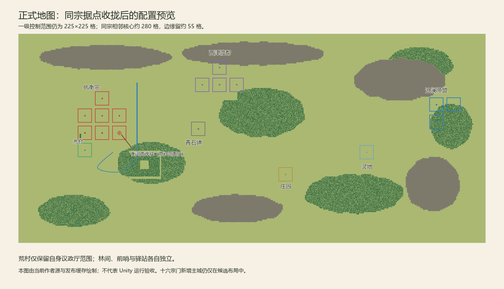
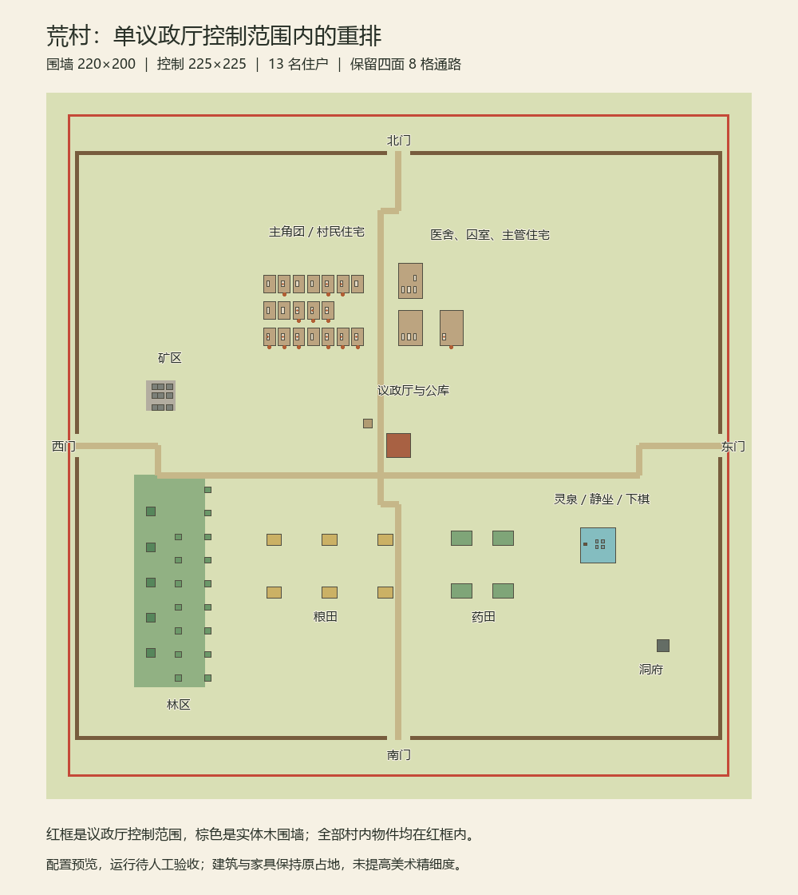

# 同宗据点收拢与荒村单议政厅布局

> 2026-10-24。Design Confirmed / Implemented / Producer Acceptance Pending / 未提交推送。制作人截图要求：同一宗门各控制范围彼此相邻、保留适度距离；荒村只使用自身议政厅控制范围，重新布置村内设施，将原补范围的旗移作别处据点。此为作者布局与内容调整，不扩行政／境界／存档框架。保留333全部成果及其高阶机制Design Only边界。

## 本轮唯一实施指令

1. 世界保持7600×3400、一级控制范围保持225×225、物件与人物尺寸不变。正式地图现有执衡宗、沧澜渔盟、西津渡帮的多个据点改为紧凑邻接，核心中心常用280格步距，控制边缘约留55格；不以增大控制范围填空隙。青石镇等其他独立势力据点不随意归并。
2. 荒村蓝图从240×200重排为220×200，议政厅居中，整圈围墙、林矿、田药、灵泉、蒲团、棋盘、洞府、住宿、医舍、囚室及13人落点全部位于单议政厅225×225理论范围内。保留建筑／床大小、用途、住户、物件身份及资源数量；房床与出生落点联动更新。四边各保留8格通路，旧墙逐格身份在仍有该格时保留；撤出的外围墙不在旧档隐式迁移。
3. `base:flag_huangcun_forest_outpost`不再与荒村叠加，保留稳定旗ID，将其移往独立的村外河路驿站；不得仍用该旗托底村内农林设施。林间议政厅、所属入口／地点、Site arrival一并搬至村外邻接位置，不能只移动战略色框。现有其他旗按同宗邻接重排并补可读名称。
4. 村内布置采用西侧林矿、中南粮药、中部议政厅与公库、北部住宿医牢、东侧灵泉与洞府；保留333的13人／双巡卫配置。村内道路经过四面缺口并绕开房屋，村外相邻据点补短连接路；保留既有桥，不新增未解决的跨河通路。
5. 十六宗门候选同步正式底图，特别纠正执衡宗候选主城与荒村／林间相距过远的问题。每宗内部继续采用紧凑组团；候选仍无运行发布绑定，不生成结丹／元婴人物，不发布无驻防新主城。
6. 只从作者源通过现有发布器同步正式运行Surface／Geography／WorldMap；递增内容版本、需新开局。只做必要静态引用／作者源与几何完整性核对；不启动Unity、不编写或运行自动测试、不改Freeze／ProjectSettings／Packages、不自动提交或推送。

## 人工验收目标

1. 新开局看世界地图：同色据点成邻接片区；荒村只有一个议政厅方形范围，原重叠旗已在村外独立据点。
2. 村内13人和床位、医疗、田药、林矿、蒲团／棋盘、洞府仍可用；所有设施及围墙均在单议政厅范围内，四面缺口可到达，实体墙仍阻挡。
3. 占领荒村后只取得其自身控制范围；外界解锁仍按真实荒村所有权，外部旗不自动随村归属。前往林间／河路驿站时，实物与世界地图位置一致，青石书院仍可正常找到。

## 交付与静态结果

### 正式世界

|片区|核心中心（Surface Cell）|说明|
|---|---|---|
|荒村|1082,1788|唯一议政厅；225×225控制范围不变|
|林间|1362,1788|议政厅／入口／arrival全体按同一偏移搬迁，ID及归属不变|
|衡河西岸驿|1642,1788|原`base:flag_huangcun_forest_outpost`，已离开荒村；保留旗ID和独立Site身份|
|荒村北路哨|1082,2068|现有执衡宗旗重布|
|南稷庄前哨|1362,2068|现有执衡宗旗重布，不冒充已落地的完整结丹城镇|
|赤铁坞前哨|1642,2068|同上|
|北山路哨|1362,2348|同宗北向中继|
|主角旧营|1082,1508|原主角旗保留，与荒村中心相距280；不改变取得荒村前的势力入口锁|
|沧澜渔盟|6800,2250；7080,2250；6800,1970|渔港、东汊哨、林岸驿为邻接L形|
|西津渡帮|议政厅3272,2572；三旗2992,2572／3552,2572／3272,2852|围绕青石关邻接，不再散落山脊各端|

正式世界仍有6个预置Site region和12面原稳定旗，没有增加新势力旗、范围层级或高阶人物。青石镇、庄园、灵地的既有实物与业务位置保留；各旗仍各自独立，不自动归并到荒村。

### 荒村细布局

- Blueprint仍以全局格(972,1688)为原点，改为220×200；议政厅本体左下角(106,96)、8×8，中心(110,100)。单核范围相对蓝图为X=-2.5…222.5、Y=-12.5…212.5，整圈村墙与所有物件均在内。
- 西侧树木、矿区；中南6块粮田与4块药田；中部议政厅、公库与绕行道路；北部22个原房间（含空置住宅）、27床、医舍与囚室；东部灵泉、4蒲团、棋盘与洞府。所有非墙对象原ID／尺寸／数量保留，未新增美术资源。
- 木墙从844段变为804段，均1×1。墙界X=0／219、Y=0／199，南北开口X=106…113、东西开口Y=96…103。仍存在于原格的墙保留格身份；退出的40段不留作外圈装饰墙。
- 房床与13个村内住户出生锚点同步；青石镇7人保持原333位置。没有房间相互重叠，出生点未落在静态阻挡本体内。林矿／药田业务驻留提示不再引用已迁到镇上的阿柴／阿青，药田改为村内阿兰。
- 村内道路采用两点短段绕开议政厅、仓库和住宅，避免曲线拐角越入墙体；村外补同宗短路，保留既有桥与过河位置。宏观地形、两条河及其宽度不变。

### 候选世界

候选重新继承上述正式源。15家非执衡宗的内部节点统一按280格网格邻接；执衡宗候选主城中心调整为(1082,2348)，经现有北路哨与荒村连接，林间及3个候选节点贴合实际同宗片区，不再把主城放在大陆远端。新增候选道路只连接蓝图外缘，保留每宗主城的差异分区与96据点设计总数。候选仍无发布绑定，没有把主城及高阶驻守偷偷接入正式运行。

### 核对与版本

- 现有`CompatibilityPublisher`已实际发布7600×3400正式世界，链接蓝图对象927个＝荒村903＋青石镇24。Content版本`0.0.11-compact-territories`，需新开局，Snapshot仍v17；旧档文件保留，不隐式迁移墙、旗、人物或Site位置。
- 正式作者源校验0错误／0警告；候选0错误，3条预期的“蓝图与既有地理精修块矩形重叠”警告，来自执衡宗3个节点靠近现有河岸地理块。该3蓝图没有地形覆盖数据；警告不是道路过河未解决，也不影响正式发布。
- 全包加载／内容引用／正式开局引用均0错误；任务31、事件98（含隔离验收内容），333的书院、功法斗技和委托数量不变。本轮无C#运行代码改动，不启动Unity，不编写或运行自动测试。静态核对不代表人工运行验收。
- 发布产物与最短人工验收见上；没有自动提交或推送，未混入前轮改动做Git封板。

配置预览（由当前作者数据／发布缓存绘制，非Unity截图）：

