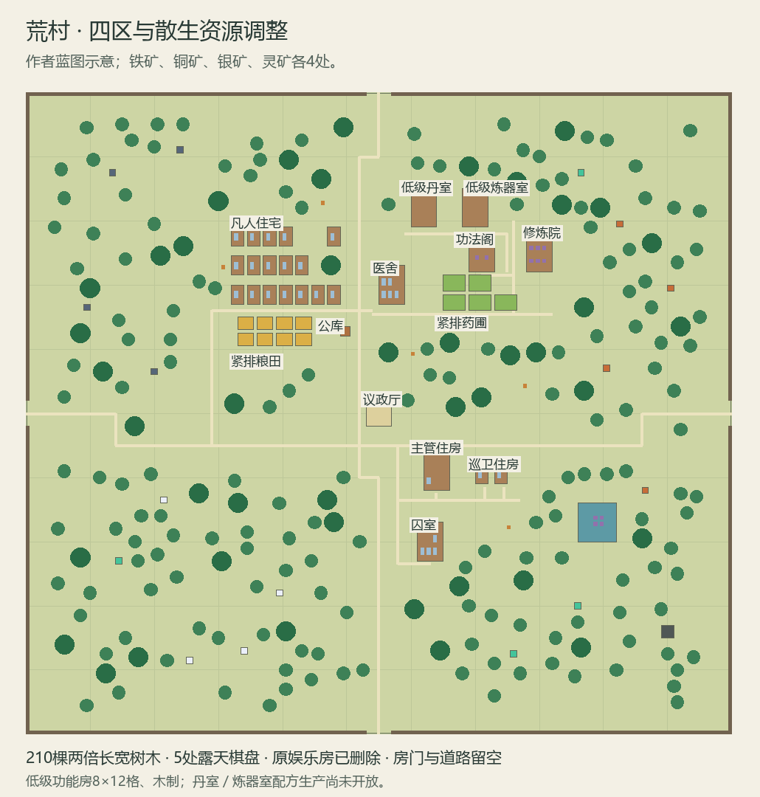

# 荒村四区布局、散生资源与低级功能房

> 2026-10-24。Design Confirmed / Implemented / Producer Acceptance Pending。制作人本轮直接指定布局、两倍树体、铁铜银灵矿及低级木制功法阁／丹室／炼器室；本文件为唯一实施入口，覆盖340相应布局，不重新开启已封板迁移。内容版本 `0.0.16-huangcun-quadrants`，需新开局，未提交推送。

## 单轮实施范围

1. 左上凡人住宅保留，粮田压紧为相邻一格田埂；主管、两巡卫住房连同真实床位／出生锚点迁到右下议政厅邻近。议政厅保留原核心坐标和225格控制范围，避免移动核心使西村墙失去覆盖。药田移到右上医舍附近，集中紧排。
2. 删除荒村娱乐／歇脚屋实体，棋盘改到户外并增加到5个，保留使用格和间隔。公共地点与对话改称露天歇脚处；不删原任务ID，不改青石已发布生活设施。
3. 荒村全部树长宽各为原类型两倍（treeM 4×4、treeL 6×6），扩至约210棵，分布全村空地；避让道路、屋门、田地、矿物及家具。取消集中伐木区的地图和对话表述，现有伐木职业工作地点仅为内部调度锚点，实际仍找合法真实树木。不会改变树产量或自动再生规则。
4. 移除整片矿区底板，铁／铜／银／灵各4处2×2露头散布。各点绑定独立地点和真实资源定义，沿用现有LaborAction的ResourceOnExplore结算，不新增矿脉耗竭／冶炼／配方系统。保留旧矿点ID作一处铁矿以兼容原见闻任务；旧稿把矿点资源误设为木头，本轮同时纠正。Host按矿种一次性着色并显示具体名称，不每帧查询全图。
5. 新增低级木制功法阁、丹室、炼器室，均8×12，沿用中型木屋规格、真实房间／门口／建造成本和耐久。仅发布低级，用户提出的中高级分级保留后续规格入口；本轮不擅定中高级配方／产能。功法阁放公共修炼位置；丹室／炼器室先提供可建造建筑与场所，不把房屋命名称作已完成炼丹／炼器。既有书册学习／贸易不变。
6. 同步蓝图、地点、道路、人物锚点、工区和方向对话；现有发布器更新正式地图并同步候选，版本0.0.16，新开局生效，旧档不强制迁移。基础编译和最少静态内容／引用／占地核对，不写或跑自动测试，不启动Unity，不提交推送。

## 人工验收

新开局查看紧排田地与右上药圃、右下主管／巡卫及床位；凡人住房保留。露天5棋盘可达可用，原歇脚屋消失。大树散布且不堵路／房门，伐木仍能产木；分别采集四矿核对背包名称。三座低级木制8×12房可进入，取得荒村后可在建造列表找到；丹室／炼器室不宣称已有配方生产。复看WASD通行、遮挡和顺滑度。

## 实施结果

- 荒村1119对象，青石64对象不变。8块粮田以一格田埂紧排，5块药田移至右上；主管房／两巡卫房的稳定ID、床位分配保留并迁到右下，囚室一起靠近值守区。出生锚点和工作地点同步，议政厅原坐标与核心范围不变。
- 荒村common_house移除；5个棋盘均在室外、互相分开，周围留出使用格。旧歇脚屋对话与方向说明改为露天棋盘／新四区，青石歇脚屋保留。
- 荒村treeM为4×4、treeL为6×6，共210棵；村内森林色块移除，实物随机散布后固定写入蓝图，运行不随机重排。道路两侧／建筑家具外围避让；不改树的血量、产木量或再生规则。旧森林地点仅留内部职业／见闻引用，隐藏地图区域名并移除抽象探索／劳动发木配置。
- 16个矿露头（铁／铜／银／灵各4处），独立地点绑定对应铁矿石／铜矿石／银矿石／灵矿石，沿用LaborAction一次完工产1份的既有规则。灵矿石为资源物品，不自动兑换成灵石钱包。原base:loc_ref_mine保留为一处铁矿，原见闻任务仍能完成；矿区底板移除。
- Host在矿点创建时按地点资源一次性着色，悬浮信息保留具体矿名；共享矿石贴图，无新材质、逐帧矿点扫描或新Snapshot字段。
- 新增3个可建造低级功能房定义（木制8×12、中型木屋成本工时和耐久）：功法阁、丹室、炼器室；功法阁内2个公共蒲团。原8×12修炼院的建筑定义同步纠正为中型木屋，避免未来重建成4×6。功能房等级与住宅尺寸不是同一概念；本轮只发布低级。
- 建筑、资源、作者源、正式地图、候选地点／人物锚点／道路与相关对话同步。四程序集基础编译、BaseGame静态JSON／schema／引用校验通过，新增主要实体占地无交叠；未启动Unity、未执行自动测试，运行与视觉待人工验收。

