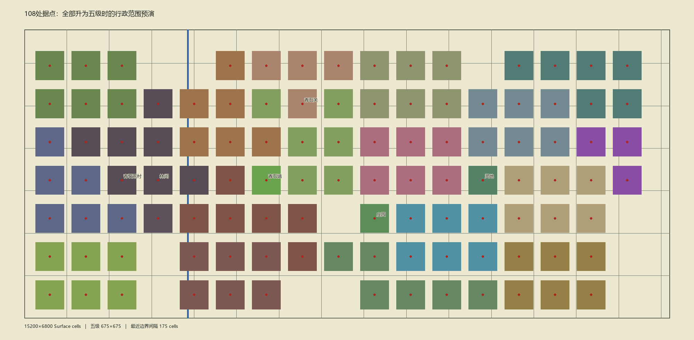

# 347｜五级城镇互不相接与主世界扩图

> 2026-10-25。决策入口：[ADR-0056](43-decisions/ADR-0056-five-level-town-separation-and-world-expansion.md)。状态：**Design Confirmed / Implemented / Producer Acceptance Pending**。本页是这一轮实施与人工验收入口；[345](345-fixed-sites-and-town-levels-architecture-change-2026-10-25.md) 的 7600×3400 与理论范围可重叠论述仅是当时基线，已由本轮覆写。

> **后续布局覆写：** [348 自然错落的世界城镇与青石镇街区](348-natural-town-layout-and-qingshi-urban-quarter-2026-10-25.md)保留 15200×6800、108 Site 和五级至少 75 格缓冲，但替换了本页等距中心与最小 175 格这一轮的具体落点。当前落点及道路、蓝图以 348 为准；本页坐标表和预演图仅记录当时实施。

制作人要求 108 个既有 Site 即使全部升到五级，任意两城（含同宗门）控制范围也不贴边，之间留野外。一级 225×225 格、五级 675×675 格及 Site 身份沿用 ADR-0055。本轮把同一 Continuous Surface 从 **7600×3400** 扩到 **15200×6800** 格，并重排全部 108 个核心中心。中心坐标和迁移清单见 [347 坐标表](347-world-expansion-site-centers.tsv)；旧坐标栏中原六个固定地点记录的是旧到达点，102 个原旗据点记录的是旧核心点，新坐标栏一律是新议政厅核心中心。108 个中心从间距 850×900 格的候选位分配，五级方框两两轴向不相交；最近的一对边界仍相隔 **175 格**，大于 75 格下限。地图边缘也预留至少 212.5 格。名称、Site ID、Owner 与初始等级不变：荒村一级、青石及 102 个原旗据点三级、另四处一级。

作者 composition、108 处蓝图摆放、地点与开局人物锚点、实体道路、河桥、树林／山地作者格和青石验收小队绝对位置一起迁移。道路沿同岸站点串联并接回既有河桥；建成区脚下的作者地形整理为平地，野外林地与山地保留。此轮改变开局地理，不改变旧档文件；BaseGame 版本升为 `0.0.19-separated-world`，须新开局。

扩图后精确地理为 **15200×6800＝1.0336 亿格**，50×50 格 Chunk 为 **304×136＝41,344 个**。运行地理行采用 `rle1` 无损压缩，省去重复的逐 Chunk 行副本；加载后仍逐格解码为原始导航，不改变 Surface authority。导航直接接收解码数组，避免再次复制一整张地图；超过 400 万格的寻路网格改用按已探索节点增长的 A* 工作区，防止首次绕障时预留整图多份数组。世界图缓存每 4 格采一个显示像素，显示坐标以缓存 `cellSize` 对齐；这只改变地图底图分辨率，不改变移动、碰撞或行政边界。大图的加载时间与实际移动帧时仍须 Unity 人工验收，基础编译和静态几何检查不能替代。

## 制作人人工验收

1. 新开局打开世界图，观察同宗与异宗的邻近城镇；青石、荒村和宗门据点应明显隔开。逐级升级相邻两城至五级时，两个行政方框之间仍有野外。
2. 沿城际道路前往邻城并过河桥，再到青石镇；建筑应落在平地，树林、山地和河桥不应错误覆盖主要街区或阻断出入口。
3. 荒村和青石 1 倍速、20 倍速 WASD 跨 Chunk；若有卡顿，用 F9 比较加载峰值与帧率，并核对首次进游戏的加载时长。旧版本存档应提示新开局且保留原文件。

未自行启动 Unity，未运行自动测试，未以编译结果宣称运行验收，也未提交／推送本轮改动。
