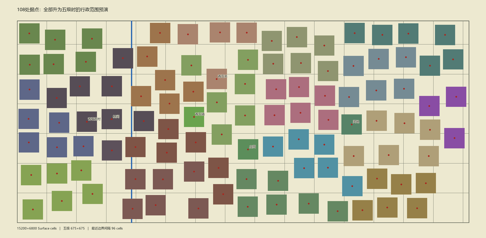
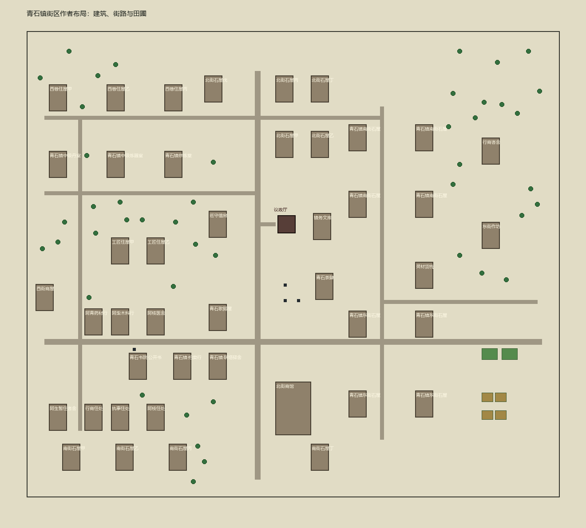

# 348｜自然错落的世界城镇与青石镇街区完善

> 2026-10-25。制作人确认：大地图城镇位置不应排列为规则方阵；“横平竖直”只用于**单座城镇内部**的道路与建筑方向。本轮状态：**Design Confirmed / Implemented / Producer Acceptance Pending**。沿用 [ADR-0055](43-decisions/ADR-0055-fixed-council-hall-sites-and-five-level-control-range.md) 与 [ADR-0056](43-decisions/ADR-0056-five-level-town-separation-and-world-expansion.md) 的规则、ID 和五级最小 75 格野外缓冲。

## 一轮实施范围

1. 在现有 15200×6800 连续世界内重排 108 个固定 Site 为不等距、错列的自然分布；保留各宗门大致方位关系、身份、Owner 和开局等级，全部五级时任何两处范围仍不相接。蓝图、Site／人物／服务锚点、青石验收小队和内部道路跟随各自据点，城际道路重新连接；河桥仍是既有正式过河点。
2. 修正上一轮扩图遗留的宗门据点内部道路坐标偏离问题。旧城址清出的树林／山地按原作者地形恢复，再仅清理新建成区脚下的地形，避免世界图出现一排空白方框。
3. 青石镇保留已有书院、拍卖、坊市、医馆、议政厅、住户及真实服务身份，整理为可辨识的两条正交主街和少量必要支路。把公共建筑做出不同体量与前庭，充实沿街铺居、茶肆／客栈、巡守／货栈、修炼及医疗陈设；田圃移到城区边缘，树木改为街边和院落散布。新增建筑的可用行为只接既有系统，不把尚未设计的炼丹／炼器、住宿、治安功能伪装成已开放玩法。
4. 其他宗城、节点和独立固定地点也做少量有身份差异的建筑／街边内容，使其不只是一张重复的住宅方阵；不擅增人口或新玩法。作者源和三份正式运行地图同轮发布，提升 BaseGame 包版本以隔离旧档。基础编译和必要静态完整性检查后，由制作人新开局走查城内动线与跨 Chunk 帧时；本轮不启动 Unity 或运行自动测试，不自动提交／推送。

## 本轮落地

108 处固定 Site 在 15200×6800 连续 Surface 内改为错列、不等距位置，旧／新议政厅中心逐项见[348 坐标表](348-natural-town-site-centers.tsv)。五级理论 675×675 范围的最小轴向净距 **96 格**，108 处两两不相交，也保留 ADR-0056 的至少 75 格野外底线；原 Site ID、名称、Owner 与初始等级未改。城际道路按新位置同岸重接、河桥保留。上一轮 318 段宗门内部道路存在从世界原点翻倍而脱离本镇蓝图的问题，已按各自蓝图的旧／新位置重接；旧址被清空的地形只在新建成区下重新整平。

青石镇实体蓝图由 200×190 扩为 **240×210 格**。两条纵横主街、北街、西侧住巷、东侧居住支路和必要的短路构成清楚路网；议政厅周边新增市场厅、茶肆、货栈、巡守所、档案屋、街边作坊、客栈等八处公共／沿街空间，并补 14 间沿街住屋，房屋总数为 44。原有书院、坊市、拍卖、医馆等服务身份保留。房间使用正式支持的 8×12 中级石屋及一间 16×24 高级石制商馆，田圃和粮仓移向东缘，45 棵小树以散布方式布置，补室外棋盘、蒲团及医馆内恢复位置。其他 106 处蓝图共补 258 间沿街房／铺居，继续使用已实现的建筑表现；这些空间不凭名称自动获得新系统行为。

作者内容包升为 `0.0.20-natural-towns`，旧档需保留文件并新开局。静态核对：108 处五级范围无重叠、蓝图实体足迹无互压、468 段道路在 Surface 边界内。世界制作工具的“森林格是否覆盖水域”验证改为按编辑格索引查找，保留原判定，避免扩图后重复全表扫描。作者源已重新发布三份正式运行地图，发布器报告 12,956 个蓝图物件与 468 段道路；运行地理为 15200×6800 格、6,800 行 `rle1`，与世界图缓存 `sourceHash` 一致。202 份蓝图可由制作工具读取，建筑引用无缺项，Core／Data 基础编译 0 警告、0 错误。未启动 Unity、未运行自动测试、未提交／推送；街区通行、外观和新内容对帧时的影响仍待制作人人工验收。

## 制作人人工验收

新开局查看世界图：城镇不再呈横竖等距方阵，同宗和异宗仍隔着野外。走进青石镇，从道路入口沿主街依次能辨认坊市、书院、拍卖、医馆和议政厅，住房与生产边缘有清楚路径；到一处宗门节点确认路直接通向实体街区。按 F9 对比荒村／青石及城际跨 Chunk 的移动帧时，并核对旧档提示新开局且原文件仍在。
